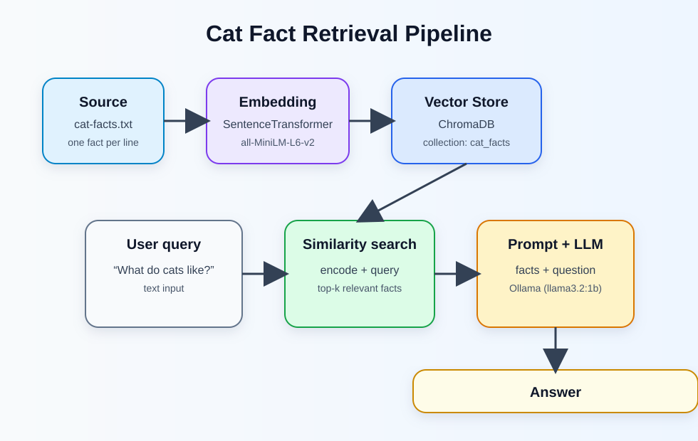

# Cat Fact Retrieval Demo

This project loads cat facts from a text file, converts them into embeddings, stores them in a local ChromaDB collection, and then answers questions by retrieving the most relevant facts and sending them to Ollama.

## What the script does

- Reads each line from `cat-facts.txt` as a fact
- Encodes the facts with `SentenceTransformer('all-MiniLM-L6-v2')`
- Stores the embeddings in a persistent ChromaDB collection named `cat_facts`
- Encodes the user question and queries the collection for top matches
- Builds a prompt from the matched facts and the original question
- Sends that prompt to Ollama (`llama3.2:1b`) for a grounded answer

## Workflow



```mermaid
flowchart LR
    A[cat-facts.txt] --> B[Load facts]
    B --> C[SentenceTransformer embeddings]
    C --> D[(ChromaDB: cat_facts)]
    E[User question] --> F[Encode query]
    F --> G[collection.query()]
    D --> G
    G --> H[Top relevant facts]
    H --> I[Prompt with facts + question]
    I --> J[Ollama chat]
    J --> K[Answer]
```

## Files

- `ingestion.py` — main workflow and interactive loop
- `cat-facts.txt` — source facts
- `visualization.svg` — visual summary of the pipeline
